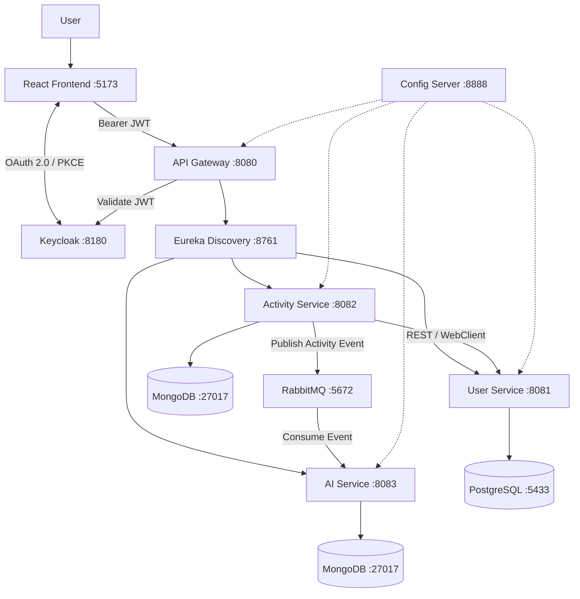
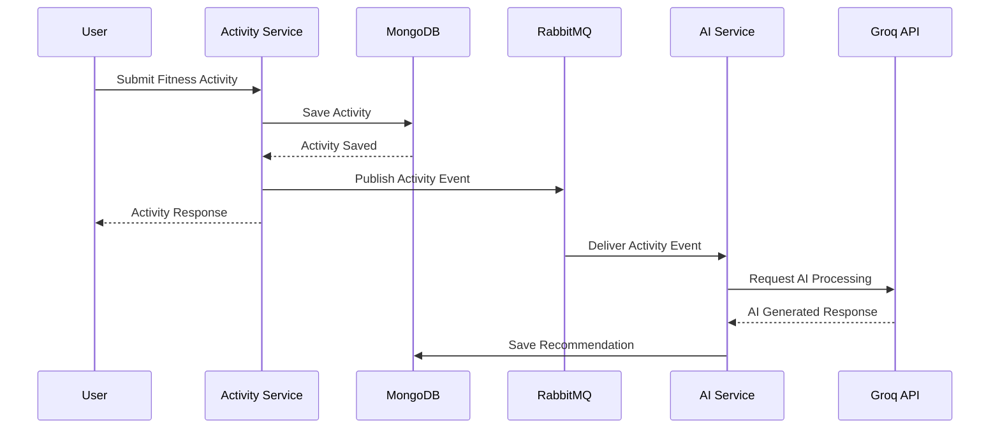

#  Fitness Microservices Platform

A full-stack fitness tracking platform built using **Java, Spring Boot and React**, following a distributed microservices architecture.

The platform separates user management, fitness activity tracking, and AI-powered recommendations into independently running services. It integrates Keycloak for authentication, RabbitMQ for asynchronous event processing, Eureka for service discovery, and Spring Cloud Config for centralized configuration.

---

##  Project Overview

The goal of this project is to build a modular fitness platform where users can securely manage their accounts, record fitness activities, and receive AI-generated recommendations.

Rather than implementing the entire backend as a single monolithic application, the system divides its functionality into independent microservices.

Each service has its own responsibilities, configuration, and data persistence mechanism.

### Key Features

- **Microservices Architecture:** Six independent Spring Boot services with clearly separated responsibilities.
- **Secure Authentication:** Keycloak integration using OAuth 2.0 Authorization Code Flow with PKCE.
- **JWT Validation:** Centralized token validation at the API Gateway.
- **Service Discovery:** Dynamic service registration and discovery using Netflix Eureka.
- **Centralized Configuration:** Spring Cloud Config Server with the native configuration profile.
- **Asynchronous Communication:** RabbitMQ-based event processing between Activity and AI services.
- **Multiple Databases:** PostgreSQL for user information and MongoDB for activity and recommendation data.
- **AI-Powered Recommendations:** Integration with Groq API for fitness-related AI processing.
- **React Frontend:** Interactive user interface built with React, Vite, Material UI, and Redux Toolkit.
- **CI/CD Automation:** GitHub Actions workflow for Maven builds and an SSH-based EC2 deployment stage.

---

##  System Architecture

The application follows a distributed microservices architecture using Spring Cloud components.

### Architecture Diagram



### Architecture Components

| Component | Port | Responsibility |
|---|---:|---|
| API Gateway | 8080 | Centralized request routing and JWT validation |
| User Service | 8081 | User management and PostgreSQL persistence |
| Activity Service | 8082 | Fitness activity management and event publishing |
| AI Service | 8083 | AI processing and recommendation management |
| Config Server | 8888 | Centralized configuration |
| Eureka Server | 8761 | Service registration and discovery |
| Keycloak | 8180 | Identity and access management |
| RabbitMQ | 5672 | Asynchronous message communication |
| RabbitMQ Management | 15672 | Message broker administration |
| PostgreSQL | 5433 | Relational user database |
| MongoDB | 27017 | Activity and recommendation storage |
| React Frontend | 5173 | Client application |

---

## ⚙️ Microservices Breakdown

### 1. User Service

**Port:** `8081`

Responsible for managing user-related information.

Responsibilities:

- User registration and profile management.
- Persisting user information in PostgreSQL.
- Database operations using Spring Data JPA.
- Exposing REST APIs for user-related functionality.
- Registering with Eureka for service discovery.

**Technologies:**
- Spring Boot
- Spring Data JPA
- PostgreSQL
- Spring Cloud Config
- Netflix Eureka Client

### 2. Activity Service

**Port:** `8082`

Responsible for managing fitness activities recorded by users.

Responsibilities:

- Creating and retrieving fitness activity records.
- Persisting activity data in MongoDB.
- Validating users through communication with the User Service.
- Publishing activity events to RabbitMQ.
- Communicating with other services using WebClient.

**Technologies:**
- Spring Boot
- Spring Data MongoDB
- Spring WebClient
- Spring AMQP
- RabbitMQ
- Netflix Eureka Client

### 3. AI Service

**Port:** `8083`

Responsible for processing fitness activity events and generating AI-powered recommendations.

Responsibilities:

- Consuming activity events from RabbitMQ.
- Processing activity-related information.
- Integrating with Groq API for AI-generated responses.
- Persisting recommendation-related information in MongoDB.
- Exposing recommendation-related REST APIs.

**Technologies:**
- Spring Boot
- Spring Data MongoDB
- Spring AMQP
- WebClient
- Groq API
- Netflix Eureka Client

### 4. API Gateway

**Port:** `8080`

Acts as the single entry point for frontend communication with backend services.

Responsibilities:

- Routing requests to appropriate microservices.
- Validating incoming JWT access tokens.
- Integrating with Keycloak's JWKS endpoint for token verification.
- Using Eureka-based service discovery.
- Managing frontend CORS configuration.

**Configured Routes:**

| Request Path | Destination |
|---|---|
| `/api/users/**` | USER-SERVICE |
| `/api/activities/**` | ACTIVITY-SERVICE |
| `/api/recommendations/**` | AI-SERVICE |

The Gateway uses Spring Cloud Gateway WebMVC, with a servlet-based application stack.

### 5. Eureka Discovery Server

**Port:** `8761`

Provides service registration and discovery.

Each microservice registers itself with Eureka when it starts.

Instead of depending on hardcoded service IP addresses, other services can locate instances using registered service names.

For example:

```text
lb://USER-SERVICE
lb://ACTIVITY-SERVICE
lb://AI-SERVICE
```

The `lb://` prefix enables service lookup through Spring Cloud LoadBalancer.

Eureka Dashboard:

http://localhost:8761

### 6. Config Server

**Port:** `8888`

Provides centralized configuration management.

The application uses Spring Cloud Config Server with the `native` profile.

Configuration files are maintained in the Config Server's classpath configuration directory.

```text
configserverc/
└── configserverc/
    └── src/main/resources/
        ├── application.yml
        └── config/
            ├── user-service.yml
            ├── activity-service.yml
            ├── ai-service.yml
            └── api-gateway.yml
```

This allows individual microservices to retrieve their configuration from a centralized location rather than maintaining every setting independently.

---

##  Communication Between Microservices

The application uses synchronous and asynchronous communication depending on the operation.

### 1. Synchronous Communication – REST APIs

REST-based communication is used when a service requires an immediate response from another service.

For example, when an activity is submitted, the Activity Service communicates with the User Service to validate the associated user.

The project uses WebClient with service discovery to communicate using registered service names.

Example:

```text
Activity Service
       |
       | WebClient
       v
USER-SERVICE
       |
       v
PostgreSQL
```

### 2. Asynchronous Communication – RabbitMQ

RabbitMQ is used to decouple activity recording from AI recommendation processing.

**Activity Event Workflow:**



**RabbitMQ Configuration**

| Property | Value |
|---|---|
| Exchange | `fitness.exchange` |
| Queue | `activity.queue` |
| Routing Key | `activity.tracking` |
| AMQP Port | `5672` |
| Management Port | `15672` |

**Why RabbitMQ?**

AI processing can take longer than normal database operations.

By publishing an event to RabbitMQ, the Activity Service does not need to wait for the AI Service to complete its processing before responding to the activity request.

This provides:

- Loose coupling between services.
- Independent event processing.
- Better separation of business responsibilities.
- Reduced dependency on synchronous AI processing.

---

## 🔐 Authentication and Security

The application integrates Keycloak as an external identity and access management solution.

It uses OAuth 2.0 Authorization Code Flow with PKCE through the React frontend.

### Authentication Workflow

1. The user initiates login from the React application.
2. The frontend redirects the user to Keycloak.
3. Keycloak authenticates the user.
4. The frontend completes the PKCE authorization flow and receives an access token.
5. The frontend attaches the token to protected API requests.

Example:

```http
Authorization: Bearer <access_token>
```

6. The request reaches the API Gateway.
7. Spring Security validates the JWT using Keycloak's public signing keys obtained through the JWKS endpoint.
8. Valid requests are routed to the appropriate backend service.

**Keycloak Configuration**

| Property | Value |
|---|---|
| Realm | `fitness-oauth2` |
| Port | `8180` |
| Protocol | OAuth 2.0 |
| Authorization Flow | Authorization Code + PKCE |
| Token Type | JWT |
| Validation | Spring Security OAuth2 Resource Server |

The configured JWKS endpoint is:

```text
http://localhost:8180/realms/fitness-oauth2/protocol/openid-connect/certs
```

Keycloak handles identity authentication, while the API Gateway validates access tokens before routing protected requests.

---

## 🗄️ Database Architecture

The project uses a polyglot persistence approach, selecting databases based on the requirements of individual services.

| Service | Database | Purpose |
|---|---|---|
| User Service | PostgreSQL | Structured user information |
| Activity Service | MongoDB | Fitness activity documents |
| AI Service | MongoDB | Recommendation-related documents |

### PostgreSQL

Used by the User Service for relational data storage.

Integration is implemented using Spring Data JPA and Hibernate.

Configured database name:

`fitness_user_id`

### MongoDB

Used by the Activity and AI services for document-based persistence.

Configured databases:

- `fitnessactivity`
- `fitnessrecommendation`

Using separate databases allows the services to manage their own data independently.

---

## 🖥️ Frontend Architecture

The frontend is developed using React and Vite.

**Technologies:**

| Technology | Purpose |
|---|---|
| React | UI development |
| Vite | Frontend development server and build |
| Material UI | UI components |
| Redux Toolkit | State management |
| React Redux | React state integration |
| React Router | Client-side navigation |
| Axios | HTTP requests |
| react-oauth2-code-pkce | OAuth 2.0 authentication |

**Frontend URL:**

http://localhost:5173

The frontend communicates with backend services through the API Gateway.

---

## 🚀 Getting Started

### Prerequisites

Install the following before running the project:

- Java 21
- Maven
- Node.js and npm
- PostgreSQL
- MongoDB
- RabbitMQ
- Keycloak

### 1. Clone the Repository

```bash
git clone https://github.com/d-anchu/fitness-microservice.git

cd fitness-microservice
```

### 2. Configure Environment Variables

Copy the example environment file.

**Windows PowerShell:**

```powershell
Copy-Item .env.example .env
```

**Linux/macOS:**

```bash
cp .env.example .env
```

Configure your Groq API key:

```env
GROQ_API_KEY=your-groq-api-key
```

Optional overrides:

```env
GROQ_API_URL=https://api.groq.com/openai/v1/chat/completions
GROQ_MODEL=openai/gpt-oss-120b
```

Obtain an API key from:

https://console.groq.com/keys

Do not commit your actual `.env` file or API keys.

### 3. Start Infrastructure Services

Ensure that the following services are running:

- PostgreSQL on port `5433`.
- MongoDB on port `27017`.
- RabbitMQ on port `5672`.
- Keycloak on port `8180`.

Create the configured PostgreSQL database and configure the credentials through your local environment.

Make sure the Keycloak realm `fitness-oauth2` and the frontend client are configured correctly.

### 4. Start Backend Microservices

Start each service in a separate terminal.

**Terminal 1 – Config Server**

```powershell
cd configserverc/configserverc
mvn spring-boot:run
```

**Terminal 2 – Eureka Server**

```powershell
cd eureka
mvn spring-boot:run
```

**Terminal 3 – User Service**

```powershell
cd userservice
mvn spring-boot:run
```

**Terminal 4 – Activity Service**

```powershell
cd activityservice
mvn spring-boot:run
```

**Terminal 5 – AI Service**

```powershell
cd aiservice
mvn spring-boot:run
```

**Terminal 6 – API Gateway**

```powershell
cd gateway/gateway
mvn spring-boot:run
```

Run these commands from the repository root, using separate terminals.

### 5. Start Frontend

Open another terminal:

```bash
cd fitness-app-frontend

npm install

npm run dev
```

Open the application:

http://localhost:5173

---

##  GitHub Actions – CI/CD Pipeline

The repository contains a GitHub Actions workflow at:

```text
.github/workflows/ci-cd.yml
```

The workflow is designed to automate backend build verification and EC2 deployment.

### Continuous Integration (CI)

The CI job runs when code is pushed to `main` or a pull request targets `main`.

Workflow:

1. Checkout the repository.
2. Set up Java 21 using Eclipse Temurin.
3. Configure Maven dependency caching.
4. Execute the Maven verification lifecycle.

Build command:

```bash
mvn -B -ntp clean verify
```

This builds the Maven modules and executes the available verification and test phases.

### Continuous Deployment (CD)

The deployment job is configured to run after successful CI when code is pushed to the `main` branch.

Deployment workflow:

```text
GitHub Repository
       |
       v
GitHub Actions
       |
       v
Backend CI Successful
       |
       v
SSH Connection to AWS EC2
       |
       v
Fetch Latest Source Code
       |
       v
Docker Compose Build & Restart
       |
       v
Check Running Containers
```

The deployment workflow uses SSH to connect to an EC2 instance and execute deployment commands.

**GitHub Repository Secrets**

| Secret | Purpose |
|---|---|
| `EC2_HOST` | EC2 public IP or DNS |
| `EC2_USER` | EC2 SSH username |
| `EC2_SSH_KEY` | Private SSH key |

The deployment stage expects Docker Engine, Docker Compose, and a valid Compose configuration on the EC2 instance.

**Note:** The workflow is committed and configured in the repository. Successful AWS deployment is not yet verified.

---

##  Project Structure

```text
fitness-microservice/
│
├── activityservice/
│   └── src/
│
├── aiservice/
│   └── src/
│
├── userservice/
│   └── src/
│
├── gateway/
│   └── gateway/
│       └── src/
│
├── eureka/
│   └── src/
│
├── configserverc/
│   └── configserverc/
│       └── src/
│
├── fitness-app-frontend/
│
├── docs/
│
├── .github/
│   └── workflows/
│       └── ci-cd.yml
│
├── .env.example
├── START-ALL-SERVICES.ps1
├── TEST-ALL-MICROSERVICES.ps1
├── VERIFY-SYSTEM.ps1
├── pom.xml
└── README.md
```

---

## 🧠 Design Decisions

### 1. Why RabbitMQ instead of synchronous AI processing?

AI recommendation generation can take considerably longer than normal database operations.

If the Activity Service directly waits for the AI Service to finish generating a recommendation, the activity-recording request becomes dependent on AI processing time.

To avoid this tight coupling, RabbitMQ is used for asynchronous communication.

**Workflow:**

1. The Activity Service receives a fitness activity.
2. The activity is persisted in MongoDB.
3. An activity event is published to RabbitMQ.
4. The Activity Service can return its response without waiting for AI processing to finish.
5. The AI Service independently consumes the event and generates recommendations.

This approach provides:

- Loose coupling between Activity and AI services.
- Independent processing of AI-related workloads.
- Reduced dependency on synchronous communication.
- Better support for handling increasing workloads.

### 2. Why Eureka and Spring Cloud Config?

**Eureka – Service Discovery**

In a distributed system, microservices need to communicate with one another without depending on hardcoded IP addresses.

Eureka provides a central service registry where individual services register themselves.

For example:

- User Service registers as `USER-SERVICE`.
- Activity Service registers as `ACTIVITY-SERVICE`.
- AI Service registers as `AI-SERVICE`.

Other services can discover these registered instances using their service names.

This makes service communication more flexible when service instances or their network locations change.

**Spring Cloud Config – Centralized Configuration**

Maintaining separate configuration properties across multiple microservices can become difficult as the application grows.

Spring Cloud Config provides a centralized configuration mechanism.

Instead of independently managing configuration files in every service, services retrieve their configuration from the Config Server.

This simplifies configuration management and reduces duplication.

### 3. Database Separation – PostgreSQL and MongoDB

The application uses different databases based on the responsibilities of individual microservices.

- **PostgreSQL:** Used by the User Service for structured relational user information.
- **MongoDB:** Used by the Activity Service for fitness activity documents and by the AI Service for recommendation-related information.

This follows the Database-per-Service architectural principle.

Each microservice manages its own data instead of directly accessing another service's database.

Benefits include:

- Reduced database coupling.
- Independent data management.
- Flexibility in choosing persistence technologies.
- Independent evolution of service data models.

### 4. Security – Keycloak, OAuth 2.0 and JWT

Instead of implementing authentication and credential management independently inside every microservice, the application delegates identity management to Keycloak.

The frontend uses OAuth 2.0 Authorization Code Flow with PKCE.

The API Gateway acts as a centralized security boundary for protected backend routes.

**Security workflow:**

1. Keycloak authenticates the user.
2. The frontend obtains an access token.
3. The frontend attaches the JWT to API requests.
4. The Gateway validates the token using Keycloak's public signing keys.
5. Valid requests are routed to the appropriate backend service.

This approach provides centralized authentication and avoids duplicating token-validation logic across the Gateway's downstream routing layer.

### 5. API Gateway instead of exposing individual microservices

Without an API Gateway, the frontend would need to communicate directly with multiple backend services.

This would expose individual service endpoints and make frontend integration more complicated.

The application uses Spring Cloud Gateway as a single entry point.

Responsibilities include:

- Centralized JWT validation.
- Request routing.
- Service discovery integration.
- CORS configuration.

The frontend communicates with the Gateway rather than directly managing connections to every backend microservice.

This also provides a convenient place to introduce additional cross-cutting concerns such as rate limiting and request logging.

### 6. Fault Tolerance and Reliability

The application uses asynchronous messaging to reduce direct dependencies between the Activity Service and AI Service.

If AI processing is temporarily unavailable, activity recording does not need to wait for the AI Service to complete its work.

RabbitMQ acts as an intermediary that can hold messages while consumers are unavailable, provided the queue, messages, and broker persistence are configured appropriately.

The architecture also separates user data, activity data, and recommendation data across different services.

This helps isolate failures and makes individual services easier to maintain.

**Important reliability considerations for future implementation:**

- Durable queues and persistent messages.
- Manual message acknowledgements.
- Retry mechanisms for failed processing.
- Dead-letter queues for messages that cannot be processed.
- Idempotent consumers to prevent duplicate processing.

### 7. Further Scaling

The microservices architecture allows individual components to scale independently.

For example:

1. **Horizontal Scaling of AI Service:** If recommendation-generation requests increase, multiple AI Service instances can be deployed to consume messages from the same RabbitMQ queue.

2. **RabbitMQ Load Leveling:** During sudden traffic spikes, messages can accumulate in the queue instead of forcing the AI Service to process every request immediately.

3. **Independent Service Scaling:** Activity Service and User Service can be scaled independently depending on their workloads.

4. **Load Balancing:** Eureka and Spring Cloud LoadBalancer can help distribute requests across multiple registered service instances.

5. **Container Orchestration:** Kubernetes can be introduced later to manage container deployment, service discovery, health checks, and scaling.

### 8. Further Improvements

The following improvements can make the platform more reliable and production-ready:

1. Implement retry mechanisms for failed RabbitMQ message processing.
2. Introduce Dead Letter Exchanges and Dead Letter Queues.
3. Implement circuit breakers using Resilience4j for inter-service communication.
4. Add centralized logging using the ELK stack.
5. Introduce monitoring and metrics using Prometheus and Grafana.
6. Implement distributed tracing using OpenTelemetry.
7. Introduce Docker Compose for consistent local development environments.
8. Implement Kubernetes-based deployment and horizontal scaling.
9. Introduce caching using Redis for frequently accessed user and activity data.
10. Implement comprehensive unit and integration testing.

### 9. Why Spring Boot Microservices instead of a Monolithic Backend?

A monolithic backend would combine user management, activity tracking, and AI processing within one application.

Although simpler initially, this can make independent development and scaling difficult as functionality increases.

The microservices approach separates these responsibilities into independently running applications.

For example, AI recommendation processing can be scaled without necessarily scaling the User Service.

This provides better separation of concerns and flexibility as the platform evolves.

---

## 🏛️ Design Patterns and Architectural Principles

### 1. API Gateway Pattern

The application implements the API Gateway pattern using Spring Cloud Gateway.

Instead of allowing the frontend to communicate with individual microservices directly, requests enter through a centralized Gateway.

```text
              React Frontend
                    |
                    v
               API Gateway
                    |
          ---------------------
          |         |         |
          v         v         v
       User      Activity     AI
       Service    Service   Service
```

The Gateway handles request routing and centralized JWT validation.

This simplifies frontend communication and provides a centralized entry point to the backend.

### 2. Database-per-Service Pattern

Each microservice owns its respective data and database interactions.

```text
       User Service
            |
            v
        PostgreSQL


      Activity Service
            |
            v
          MongoDB


        AI Service
            |
            v
          MongoDB
```

This prevents direct database dependencies between services and allows each service to manage its persistence independently.

### 3. Event-Driven Architecture

The Activity Service and AI Service communicate through asynchronous events using RabbitMQ.

Instead of requiring both services to participate in the same synchronous request, the Activity Service publishes an event that the AI Service consumes independently.

This separates activity recording from recommendation processing.

### 4. Service Discovery Pattern

Eureka implements service registration and discovery.

Microservices register themselves with Eureka, allowing other services to discover them using logical service names rather than hardcoded network locations.

This makes communication more flexible when service instances change.


##  Future Improvements

Potential improvements to the platform include:

1. **Fitness Analytics:** Introduce weekly and monthly workout trends, progress comparisons, and visual performance dashboards.
2. **Advanced Recommendations:** Improve AI recommendations using historical workout data and user activity patterns.
3. **Containerization:** Introduce Dockerfiles and Docker Compose for reproducible local environments.
4. **Cloud Deployment:** Complete deployment to AWS EC2 with managed database infrastructure.
5. **Orchestration:** Explore Kubernetes for container orchestration and service scaling.
6. **Observability:** Integrate centralized logging, metrics, and distributed tracing.
7. **Automated Testing:** Expand unit and integration testing across all microservices.

---


GitHub: [@d-anchu](https://github.com/d-anchu)

Project: [Fitness Microservices](https://github.com/d-anchu/fitness-microservice)

